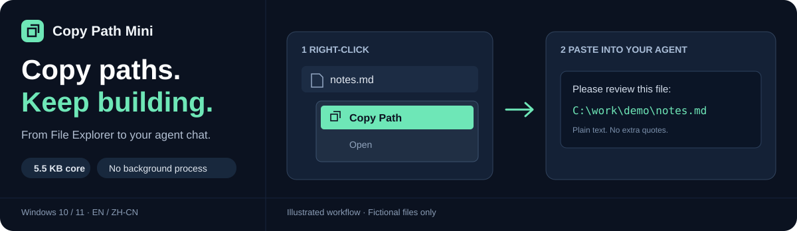

# Copy Path Mini

**A tiny Windows right-click path copier for local AI coding workflows.**

[](https://github.com/vx790905119-svg/copy-path-mini/actions/workflows/verify.yml) · **[MIT licensed](LICENSE)**

[English](README.md) · [简体中文](README.zh-CN.md) · [Download](https://github.com/vx790905119-svg/copy-path-mini/releases/latest) · [Agent reference](AGENT_GUIDE.md)



Working with **Codex, Claude Code, Cursor, Cline, or another local coding assistant**? File paths are how you point an agent at the right code, log, screenshot, or document. Copy Path Mini puts **Copy Path** near the top of the classic Windows Explorer context menu and copies a plain, unquoted path to the clipboard.

**Right-click → Copy Path → paste into your agent chat.** No plugin or agent integration required.

## Download and use

**[Download the Windows installer →](https://github.com/vx790905119-svg/copy-path-mini/releases/latest)**

1. Download `CopyPath-Setup-1.1.0.exe` from the release assets and run it.
2. Right-click **one file, one folder, or a folder background** and choose **Copy Path**.
3. Paste the path wherever you need it.

On **Windows 11**, choose **Show more options** if the command is not in the first menu. The tool adds a classic context-menu entry.

```text
Please review this file:
C:\work\demo\src\main.py
```

All paths and UI examples in this repository are fictional.

## Why keep it this small?

| What matters | What you get |
| --- | --- |
| Tiny footprint | **5,632-byte helper**; v1.1.0 installer is about **107 KiB** |
| On demand | Runs when clicked, then exits; **no resident process** |
| Local operation | **No network calls, telemetry, ads, or auto-updater** |
| Easy installation | Windows 10 / 11; **current user only, no administrator rights** |
| Usable paths | Plain Unicode text, with no added quotation marks |
| Two languages | English and Simplified Chinese setup and menu labels |
| Reversible setup | Existing same-name menu entries are backed up and restored on uninstall |

## Built for path-heavy agent work

- Point an AI coding assistant at a source file without retyping its path.
- Share the location of a log, screenshot, PDF, or project folder in a local agent conversation.
- Copy a folder's own path by right-clicking its empty background.
- Use the result in any application that accepts pasted text.

This is a Windows clipboard utility, not a plugin, MCP server, or filesystem-access permission grant. An agent still needs permission to read the path you share.

## Verify the download

Compare the installer hash with `SHA256SUMS.txt` attached to the same release:

```powershell
Get-FileHash .\CopyPath-Setup-1.1.0.exe -Algorithm SHA256
```

The personal-tool builds are **unsigned**. Build from source if that better fits your environment; keep your usual Windows security protections enabled.

## Build from source

Uses the Windows inbox **.NET Framework C# compiler** and **[NSIS 3.13](https://nsis.sourceforge.io/)**. No NuGet dependencies or bundled runtime.

```powershell
powershell -ExecutionPolicy Bypass -File .\build.ps1
```

If NSIS is portable or outside PATH:

```powershell
.\build.ps1 -NsisCompiler C:\Tools\NSIS\makensis.exe
```

Build output goes to `build/`. The [Windows build check](https://github.com/vx790905119-svg/copy-path-mini/actions/workflows/verify.yml) builds the helper and installer and checks an isolated install/uninstall cycle in both languages.

## Settings and removal

Setup detects your Windows display language at installation time. Unsupported languages fall back to English. To choose explicitly:

```text
CopyPath-Setup-1.1.0.exe /LANG=en
CopyPath-Setup-1.1.0.exe /LANG=zh-CN
```

Uninstall from **Windows Settings → Apps → Copy Path**, or run `Uninstall.exe` in the installation folder. You can rerun setup to change the installed language.

## A few honest limits

- **Windows only.** No macOS or Linux build.
- **One selected item at a time.** Batch path copying is not supported.
- Windows already includes **Copy as path**. This tool is for people who prefer an explicit, top-positioned classic-menu command and plain text without added quotes.
- If another application keeps the clipboard locked, try again shortly. The helper retries briefly rather than staying in the background.
- Paths are placed on the Windows clipboard. Review them before sharing them publicly.

## Help keep it useful

Free to use, modify, and share under the [MIT License](LICENSE). Installer components retain their [third-party notices](THIRD-PARTY-LICENSES.txt).

If this saves you time, **[give the project a star](https://github.com/vx790905119-svg/copy-path-mini)** so you can find it again. Have a reproducible issue or a small improvement? [Open an issue](https://github.com/vx790905119-svg/copy-path-mini/issues) or read [CONTRIBUTING.md](CONTRIBUTING.md). Please replace personal paths with fictional examples.
